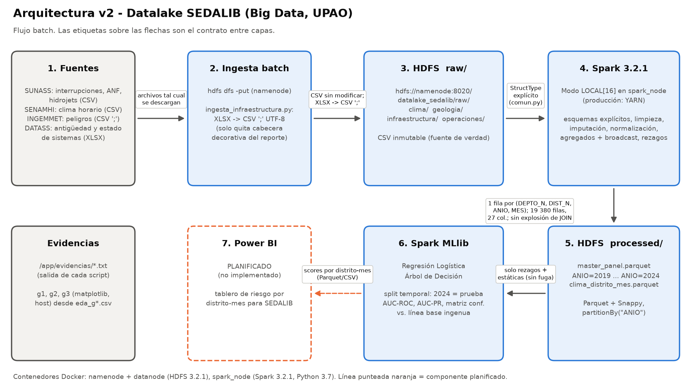

# Proyecto Big Data — Datalake SEDALIB (UPAO)

Pipeline batch sobre **HDFS + Apache Spark** para analizar las interrupciones del servicio de agua de
SEDALIB (La Libertad) cruzando datos de SUNASS, SENAMHI, INGEMMET y DATASS: limpieza, control de
calidad, panel distrito-mes en Parquet particionado, optimización de JOINs, prueba de escalabilidad
frente a pandas, EDA y un modelo base con MLlib.

## Arquitectura



Fuentes → ingesta batch → HDFS `raw/` (CSV) → Spark 3.2.1 en modo local (YARN en producción) →
HDFS `processed/` (Parquet, `partitionBy("ANIO")`) → MLlib → Power BI (planificado).

## Estructura

```
├── README.md
├── requirements.txt
├── docker-compose.yml
├── src/            scripts Spark/Python y captura de pantallas (tomar_captura.ps1)
├── evidencias/     salida completa de cada ejecución (.txt) y cifras de los gráficos (.csv/.json)
├── capturas/       capturas de terminal y Spark UI
├── graficos/       g1–g3 (EDA) y arquitectura_v2.png
├── docs/           RESUMEN_RESULTADOS.md (cifras por sección del informe)
└── data/           README.md con las fuentes (los datos no se suben)
```

## Requisitos

- Windows con Docker Desktop (probado con Docker 29.1.5 y Compose v5.0.1).
- Python 3.11 en el host: `pip install -r requirements.txt` (ingesta de XLSX, gráficos y diagrama).
- Una imagen Docker con pandas para la prueba de escalabilidad de pandas (aquí: `proyecto2-app`, pandas 2.3.3).
- Los datos de entrada en `data/raw/` (ver [data/README.md](data/README.md)).

## Levantar el entorno

```powershell
docker compose up -d                                    # namenode, datanode, spark_node (Spark UI en :4040)
docker exec spark_node apk add --no-cache py3-numpy     # numpy para MLlib (una vez por contenedor)
```

Carga a HDFS (una vez):

```powershell
docker exec namenode bash -c "hdfs dfs -mkdir -p /datalake_sedalib/raw/clima /datalake_sedalib/raw/geologia /datalake_sedalib/raw/infraestructura /datalake_sedalib/raw/operaciones"
docker exec namenode bash -c "hdfs dfs -put -f /archivos_locales/data/raw/clima/* /datalake_sedalib/raw/clima/"
docker exec namenode bash -c "hdfs dfs -put -f /archivos_locales/data/raw/geologia/* /datalake_sedalib/raw/geologia/"
docker exec namenode bash -c "hdfs dfs -put -f /archivos_locales/data/raw/operaciones/* /datalake_sedalib/raw/operaciones/"
python src/ingesta_infraestructura.py                   # XLSX -> CSV y lo sube a raw/infraestructura/
```

## Orden de ejecución

| # | Comando | Salida |
|---|---|---|
| 0 | `docker exec spark_node /spark/bin/spark-submit /app/src/diagnostico.py` | `evidencias/00_diagnostico.txt` |
| 1 | `docker exec spark_node /spark/bin/spark-submit /app/src/linea_base.py` | `evidencias/01_linea_base.txt` |
| 2 | `docker exec spark_node /spark/bin/spark-submit /app/src/procesamiento_spark.py` | `02_procesamiento.txt`, `processed/master_panel.parquet` |
| 3 | `docker exec spark_node /spark/bin/spark-submit /app/src/calidad_spark.py` | `03_calidad.txt` |
| 4 | `docker exec spark_node /spark/bin/spark-submit /app/src/optimizacion_spark.py` | `04_optimizacion.txt` |
| 5a | `docker run --rm -m 4g --memory-swap 4g -v "${PWD}:/app" --entrypoint python proyecto2-app /app/src/pandas_escalabilidad.py` | `05b_pandas_escalabilidad.txt` |
| 5b | `docker exec spark_node /spark/bin/spark-submit /app/src/escalabilidad_spark.py` | `05_escalabilidad.txt` (tabla Spark vs pandas) |
| 6 | `docker exec spark_node /spark/bin/spark-submit /app/src/analisis_modelo.py` | `06_analisis_modelo.txt`, `eda_g*.csv` |
| 6b | `python src/graficos_locales.py` | `graficos/g1..g3` |
| 7 | `python src/arquitectura_v2.py` | `graficos/arquitectura_v2.png` |
| 8 | `powershell -ExecutionPolicy Bypass -File src\tomar_captura.ps1` (o `-Solo cap05,cap06`) | `capturas/*.png` |

Para guardar la salida sin los logs INFO de Spark:
`docker exec spark_node sh -c '/spark/bin/spark-submit /app/src/calidad_spark.py 2>&1 | grep -v " INFO " | tee /app/evidencias/03_calidad.txt'`

> Las capturas y evidencias se generaron antes de mover los scripts a `src/`, por eso en ellas el
> comando aparece como `/app/<script>.py`. Después de esa reorganización también se compactó el
> formato de salida de `optimizacion_spark.py` y se agregó la exportación de probabilidades en
> `analisis_modelo.py`; los cálculos no cambiaron.

## Resultados clave

| Tema | Resultado |
|---|---|
| Línea base SEDALIB | ANF 38,00 % (sin año ni volumen en la fuente); 516 interrupciones (2020: 12, 2021: 7, 2022: 140, 2023: 245, 2024 ene–may: 112); mediana de respuesta 0 días (14,67 h); 63,37 % programadas |
| Diagnóstico | Coincidencia de distrito clima ↔ interrupciones 0 %; el JOIN anterior explotaba de 45 671 a 3 730 914 filas |
| Panel | 323 distritos × 60 meses = 19 380 filas, sin explosión en 4 JOINs; prevalencia 0,3378 |
| Calidad | 671 filas idénticas + 271 duplicados eliminados; 188 distritos nulos; 0 fechas inválidas; 0 PP fuera de 0–500 mm |
| Optimización (mediana) | SortMerge 0,536 s → Broadcast 0,270 s (1,99×) → Broadcast + 16 particiones 0,180 s (2,98×) |
| Escalabilidad | pandas (4 GiB) falla por memoria en **100X**; Spark (heap 1 GiB) completa 100X con spill (3 737 MiB memoria / 388 MiB disco) y falla en **500X** |
| Modelo M1 (2024 = prueba) | AUC-ROC: regresión logística 0,8021, árbol 0,8120, línea base ingenua 0,7907 |
| Riesgo La Libertad | Trujillo 0,994; Salaverry 0,705; Víctor Larco Herrera 0,604 |

Detalle completo por sección del informe: [docs/RESUMEN_RESULTADOS.md](docs/RESUMEN_RESULTADOS.md).

## Limitaciones de los datos

- SENAMHI solo trae 5 estaciones (Arequipa, Lima-provincias, Tacna), **ninguna en La Libertad**; el clima
  se usa como promedio departamental y solo existe para LIMA, AREQUIPA y TACNA.
- `sunass_anf.csv` no tiene año ni volumen.
- DATASS no da la edad en años: solo la categoría "≤20 años / >20 años".
